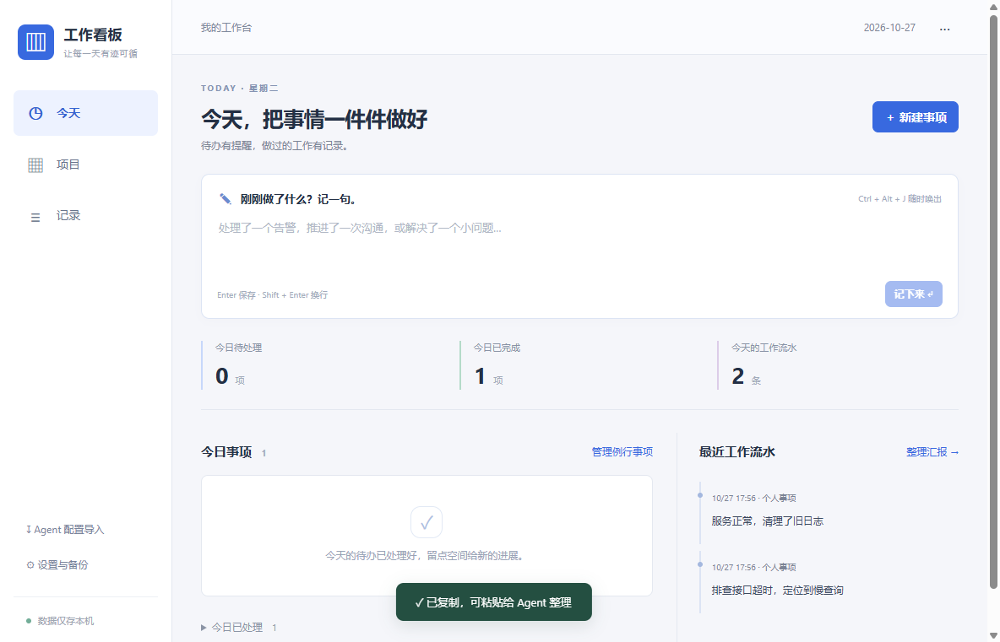

# MVP 验收记录

验收日期：2026-10-27。目标为 Windows 11 x64、本机单人、离线业务功能。

## 环境与产物

- Windows 11 专业版，10.0.26200，x64。
- Intel Core i7-14700KF，64 GiB 内存。
- 两台 2560 × 1440 显示器，实际测试缩放均为 100%。
- Electron 45.0.0，React 19.3.1，TypeScript 5.9.3。
- 产物：`dist/Kanban-0.1.0-Setup.exe`；可直接运行目录：`dist/win-unpacked`。
- 安装包采用当前用户 NSIS 安装，无签名证书；不会通过修改系统策略绕过发布者提示。

## 自动化结果

| 检查 | 结果 |
| --- | --- |
| TypeScript 类型检查 | 通过 |
| Vitest 业务测试 | 27 项通过 |
| Playwright 安装版端到端 | 7 项通过 |
| Electron 构建和 NSIS 打包 | 通过 |
| 实际安装程序 | 返回 0，安装后的程序可运行 |
| 同版本覆盖安装 | 返回 0，前后测试记录一致 |

业务测试覆盖当天实例唯一性、离线日期不补造、工作日与周规则、暂停恢复、配置同步与记录保护、撤销实例、提醒持久化、跨日稍后提醒、汇报去重、导入校验与事务回滚、备份完整性和恢复回滚。

端到端测试覆盖：

1. 创建检查清单、中文组合输入保护、完成并记录结果、汇报合并和剪贴板输出。
2. 项目创建和进度、Markdown 笔记、远程图片不加载、Agent 配置导入、渲染进程隔离。
3. 真实桌面窗口置顶且不抢焦点、主窗口关闭后驻留、稍后提醒、完成取消。
4. 快速记录窗口、快捷键注册、备份导出、恢复预览与确认恢复。文件选择器使用测试桩选择独立测试路径，实际文件和数据库操作照常执行。
5. 同数据目录第二实例退出、原程序保留、正常重启后记录仍可读取。
6. 模拟 Electron 锁屏、恢复和解锁事件，验证合并提醒和弹窗位置；验证快捷键冲突不会覆盖原设置。
7. 通过真实 SQLite 写锁触发保存失败，验证输入保留，解除锁后可以保存。

所有测试使用新建的独立目录，不读写日常使用数据库。安装测试使用项目内独立安装目录；验证结束后移除测试安装。

## PRD 验收映射

| 编号 | 证据与结论 |
| --- | --- |
| A01 | 数据层重启与安装版重启测试通过；本地文件和 SQLite 工作正常，无登录流程 |
| A02 | 工作日、周末、唯一实例和离线多日测试通过 |
| A03 | 未开始实例更新、已操作记录保护、历史不改写测试通过 |
| A04 | 实际 BrowserWindow 置顶、不获得焦点、主窗口隐藏后存活测试通过 |
| A05 | 关闭不完成、稍后提醒只修改本次，业务与界面测试通过 |
| A06 | 子项、完成、跳过、取消提醒和重复完成幂等测试通过 |
| A07 | 当天漏发合并、往日不补弹、恢复事件处理通过；未切换机器实际休眠状态 |
| A08 | 中文内容与合成组合输入事件测试通过；未逐一测试所有实体输入法候选提交行为 |
| A09 | 完成结果与任务关联，汇报只输出一条合并记录 |
| A10 | 日期首尾、补记归属日期、笔记排除和 Markdown 输出通过 |
| A11 | 重复导入、更新同 id、导出后重导入通过 |
| A12 | 未知字段、重复 id、无效日期或项目、批次中途失败均不产生部分写入 |
| A13 | 项目进度独立维护，归档后任务及记录保留 |
| A14 | 完整恢复、损坏文件拒绝、提醒状态验证、当前库覆盖保护、失败回滚通过 |
| A15 | 暂停时不生成或提醒，恢复不补暂停日期，历史保留 |

## 一万条记录性能

下表是本机单次测量，作为 MVP 基线，不代表所有办公电脑的性能保证。桌面测试使用已安装程序；启动计时包含自动化连接，界面保存计时包含输入操作。

| 项目 | 实测 |
| --- | --- |
| 安装版启动至首页可操作 | 730.41 ms |
| 安装版新增流水并显示成功 | 96.20 ms |
| 安装版进入记录列表 | 65.57 ms |
| 安装版筛选一万条记录 | 41.32 ms |
| 数据层单条保存 | 0.72 ms |
| 数据层读取 10001 条快照 | 36.22 ms |
| 数据层生成汇报素材 | 18.82 ms |

记录列表分批显示，每次 100 条；首页显示最近 10 条工作流水。最小 850 × 600 窗口下无横向溢出。测试环境有双显示器，提醒窗口的落点在实际显示器工作区内。

## 试用边界

- 未主动让用户电脑进入物理锁屏或休眠；对应回调通过事件模拟验证。实际休眠恢复适合在日常试用时继续观察。
- 未改变系统缩放比例，混合 DPI 和独占全屏应用未实测。
- 覆盖安装验证使用同版本安装包；没有伪造跨版本数据迁移测试。当前数据库版本为 1，更高版本数据库会被拒绝打开。
- 开机启动设置的系统写入没有在测试中打开，避免改变用户登录行为；快捷键实际注册与冲突均已验证。
- 首版不支持账户、同步、加密、共享和服务器，数据仅在本机。

## 界面

以下截图来自隔离测试数据。

